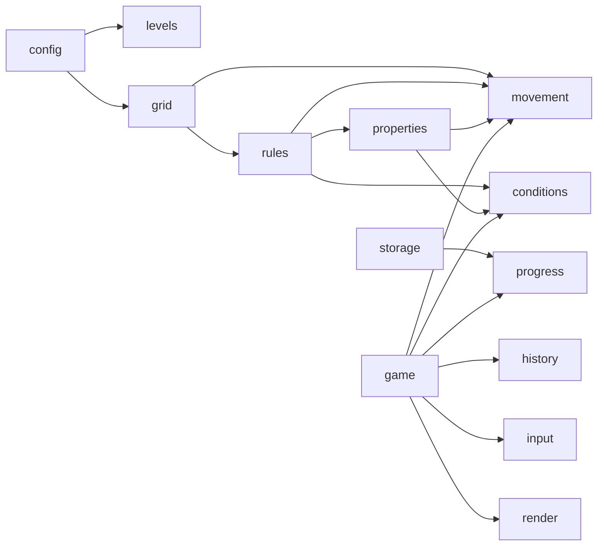

# Baba Is You

A browser puzzle game where words are the rules. Write `BABY IS YOU` and the baby becomes the piece you control. Push the words around to change how the level works. It is written in plain HTML, CSS and JavaScript with no dependencies.

## Table of contents

- [Features](#features)
- [How to play](#how-to-play)
- [Tech stack](#tech-stack)
- [Project structure](#project-structure)
- [Getting started](#getting-started)
- [Architecture](#architecture)
- [Key algorithms and design decisions](#key-algorithms-and-design-decisions)
- [Configuration](#configuration)
- [Testing](#testing)
- [Deploying to GitHub Pages](#deploying-to-github-pages)
- [Browser support and known limitations](#browser-support-and-known-limitations)
- [Commit history guide](#commit-history-guide)
- [Roadmap](#roadmap)
- [Contributing](#contributing)
- [License](#license)

## Features

- Three bundled levels with rules written as word sentences.
- Horizontal and vertical rules, such as `WALL IS STOP` or `ROCK IS PUSH`.
- Chained pushing: a line of pushable objects moves together.
- Sinking, winning and defeat states.
- Unlimited undo (up to a configurable history size) and restart.
- Level progress saved in `localStorage`, with a safe in-memory fallback.
- Keyboard and on-screen controls, responsive layout for phones, and reduced-motion support.

## How to play

Move the baby (the pink `b` tile) so that it reaches a flag (`F`). Rules are formed by three words in a row, read left to right or top to bottom: a noun, `IS`, then a property. Changing the words changes the game. Moving a rule's word can break a rule, so think before you push.

| Action | Keyboard | Touch or mouse |
| --- | --- | --- |
| Move up | `W` or `↑` | ▲ button |
| Move left | `A` or `←` | ◀ button |
| Move down | `S` or `↓` | ▼ button |
| Move right | `D` or `→` | ▶ button |
| Undo | `Z` or `U` | Undo button |
| Restart level | `R` | Restart button |
| Choose level | | Level menu |

Words available: nouns `BABY`, `WALL`, `ROCK`, `FLAG`, `WATER`; operator `IS`; properties `YOU`, `STOP`, `PUSH`, `WIN`, `SINK`.

## Tech stack

- HTML5, CSS3 and vanilla JavaScript (ES2017 or newer).
- Plain scripts that run from `file://`, each wrapped in an IIFE that attaches to `window.BIY`.
- Node.js built-in test runner (`node --test`) for unit tests.
- `localStorage` for progress, wrapped so it never throws.

## Project structure

```text
baba-is-you/
├── .gitignore
├── README.md
├── index.html
├── package.json
├── css/
│   └── styles.css
├── js/
│   ├── config.js
│   ├── levels.js
│   ├── grid.js
│   ├── rules.js
│   ├── properties.js
│   ├── movement.js
│   ├── conditions.js
│   ├── history.js
│   ├── storage.js
│   ├── progress.js
│   ├── input.js
│   ├── render.js
│   └── game.js
└── tests/
    ├── levels.test.js
    ├── grid.test.js
    ├── rules.test.js
    ├── properties.test.js
    ├── movement.test.js
    ├── conditions.test.js
    ├── history.test.js
    ├── storage.test.js
    ├── progress.test.js
    ├── input.test.js
    └── game.test.js
```

## Getting started

### Prerequisites

- A modern browser (Chrome, Edge, Firefox, Safari).
- Node.js 20 or newer, only if you want to run the tests.

### Clone and run

```bash
git clone https://github.com/your-user/baba-is-you.git
cd baba-is-you
```

Open `index.html` in your browser. No server is needed.

To run the tests:

```bash
npm test
```

## Architecture

| Module | Responsibility | Depends on |
| --- | --- | --- |
| `config.js` | Tunable values and vocabulary | none |
| `levels.js` | Level text definitions | config |
| `grid.js` | Parses level text into entities | config |
| `rules.js` | Finds `NOUN IS PROPERTY` sentences | config |
| `properties.js` | Answers which properties an entity has | rules |
| `movement.js` | Resolves moves with pushing and stopping | grid, rules, properties |
| `conditions.js` | Sinking, winning and defeat | rules, properties |
| `history.js` | Undo snapshots | config |
| `storage.js` | Safe JSON storage | config |
| `progress.js` | Unlocked level count | storage |
| `input.js` | Key to action mapping | none |
| `render.js` | DOM drawing only | config, grid |
| `game.js` | Session state and page wiring | almost everything |



## Key algorithms and design decisions

- **Rule reading.** Every noun in the grid is checked to the right and below for `IS`, then for a property word. Duplicates are removed, so the same rule written twice counts once.
- **Chained pushing.** A move plans the whole chain before applying it. If any link is blocked by an edge or a `STOP` object, the entire move is refused. The game never leaves a half-moved state.
- **Pure logic.** Movement, rules and conditions take a state and return a new one. This keeps them testable without a browser.
- **Undo as snapshots.** Each successful move stores a deep copy of the prior state. Snapshots are capped by `MAX_UNDO`.
- **Safe storage.** `localStorage` is probed first. If it is blocked or full, the game keeps working with memory only.
- **Plain scripts.** No bundler or ES modules, so the game runs from `file://`.

## Configuration

All tunable values are in `js/config.js`.

| Key | Default | Meaning |
| --- | --- | --- |
| `STORAGE_PREFIX` | `biy:` | Prefix for saved keys |
| `MAX_UNDO` | `500` | Snapshots kept for undo |
| `CELL_MIN_PX` | `24` | Smallest tile size |
| `CELL_MAX_PX` | `48` | Largest tile size |
| `BOARD_PADDING_PX` | `40` | Space reserved around the board |
| `NOUNS` | list | Words that name objects |
| `PROPERTIES` | list | Words that give objects behaviour |
| `OPERATOR` | `is` | The word that joins a noun and a property |
| `OBJECT_GLYPHS` | map | Character shown for each object |

To add a level, append an entry to `js/levels.js`. Rows must be the same width, and each character must be in the legend at the top of that file.

## Testing

| Test file | What it covers |
| --- | --- |
| `levels.test.js` | Level shape and naming |
| `grid.test.js` | Parsing, bounds, cloning, bundled levels |
| `rules.test.js` | Horizontal and vertical rules, deduplication, non-matches |
| `properties.test.js` | Word and object properties |
| `movement.test.js` | Moving, edges, stopping, chain pushing, invalid input |
| `conditions.test.js` | Winning, sinking, defeat |
| `history.test.js` | Snapshots, undo limit, clearing, invalid limits |
| `storage.test.js` | Round trips, corrupt data, failing backends |
| `progress.test.js` | Unlocking, caps, corrupt values, reset |
| `input.test.js` | Key mapping and case handling |
| `game.test.js` | Session actions, undo, restart, winning and unlocking |

Run them with `npm test`.

## Deploying to GitHub Pages

1. Push the repository to GitHub.
2. Open **Settings → Pages**.
3. Under **Build and deployment**, choose **Deploy from a branch**.
4. Select the `main` branch and the `/ (root)` folder, then save.
5. Your game will be available at `https://your-user.github.io/baba-is-you/`.

## Browser support and known limitations

- Works in current versions of Chrome, Edge, Firefox and Safari.
- Requires JavaScript and the DOM methods `replaceChildren` and `dataset`.
- Touch input uses buttons only. Swipe gestures are not implemented.
- Rules are limited to `NOUN IS PROPERTY` with the five listed properties. Text cannot be combined with other text, such as `IS NOT`.
- Progress is stored per browser, not per account.

## Commit history guide

| # | Type | What it added |
| --- | --- | --- |
| 1 | chore | Gitignore and package manifest |
| 2 | feat | Central config module |
| 3 | feat | Built-in level definitions and tests |
| 4 | feat | Grid parser and tests |
| 5 | feat | Rule derivation and tests |
| 6 | feat | Property resolution and tests |
| 7 | feat | Movement with pushing and stopping, with tests |
| 8 | feat | Win, sink and defeat evaluation, with tests |
| 9 | feat | Bounded undo history and tests |
| 10 | feat | Safe storage wrapper and tests |
| 11 | feat | Level progress tracking and tests |
| 12 | feat | Keyboard mapping and tests |
| 13 | feat | Board, rules and status rendering |
| 14 | feat | Game controller and tests |
| 15 | feat | Page shell with controls |
| 16 | style | Responsive and reduced-motion styles |
| 17 | docs | This detailed README |

## Roadmap

- [ ] Add more levels with new word combinations.
- [ ] Support `NOT` and other operators.
- [ ] Add swipe controls for touch screens.
- [ ] Add a level editor.
- [ ] Add a move counter per level in saved progress.

## Contributing

Contributions are welcome. Please keep each change in a single commit with a Conventional Commit message, and add a unit test for any new logic.

## License

This project does not include a license file, all rights are reserved.